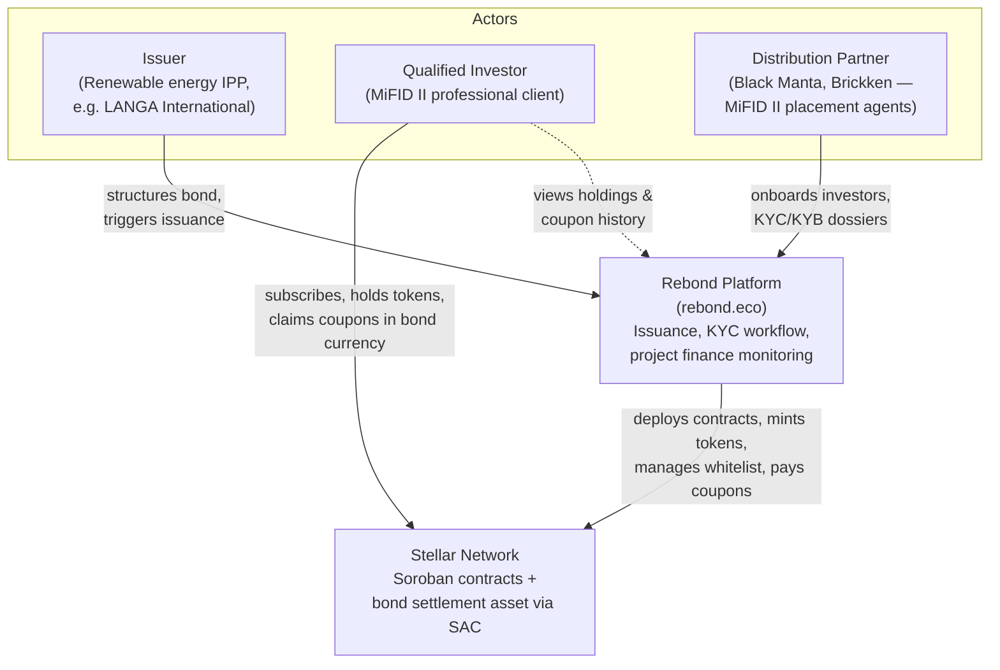
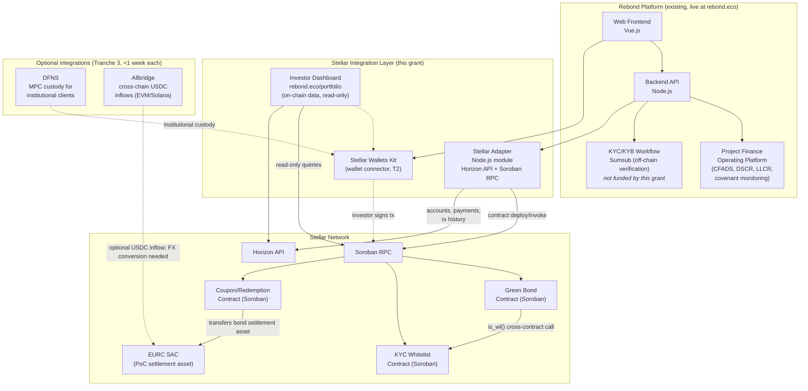
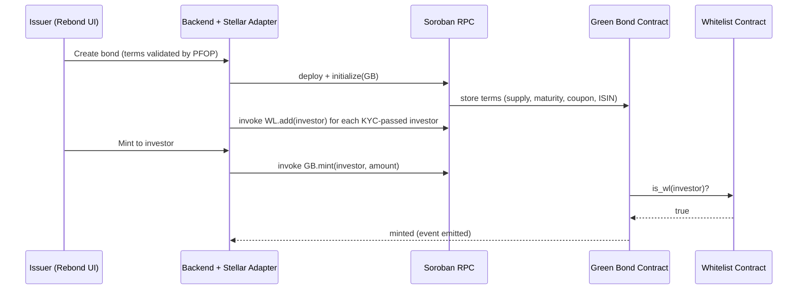
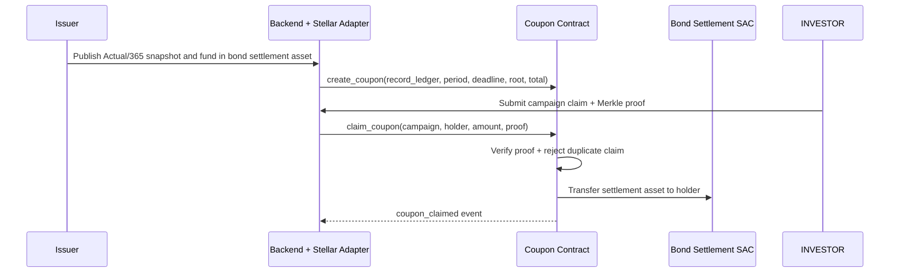

# Technical Architecture — Rebond Green Bond Tokenization on Stellar

> **Project:** Rebond — compliant green bond tokenization for European renewable energy IPPs
> **Network:** Stellar (Soroban smart contracts)
> **Status:** Contracts deployed and initialized on **Stellar testnet** (June 2026) — see [Testnet Deployments](#7-testnet-deployments)
> **Repository:** https://github.com/RenewableEnergyBond/soroban-green-bond

This document follows the C4 model: system context (L1), containers (L2), components (L3), plus runtime flows and Stellar integration points.

---

## 1. System Context (C4 Level 1)

**Problem solved:** mid-market European IPPs (€5–30M green debt deals) are excluded from traditional bond issuance due to fixed costs (€150–300K in arranging, listing and paying-agent fees per deal). Rebond replaces this with Soroban contracts and settlement in the bond's currency through Stellar Asset Contracts.

**Regulatory frame:** French *placement privé* (Art. L.411-2 CMF), MiFID II security tokens, qualified investors only — enforced **on-chain** by the KYC whitelist contract.

---

## 2. Containers (C4 Level 2)

| Container | Technology | Status | Grant scope |
|---|---|---|---|
| Web Frontend | Vue.js | Live (multi-chain) | — |
| Backend API | Node.js | Live | — |
| Project Finance Operating Platform | Node.js | Live at rebond.eco | — |
| KYC/KYB Workflow | **Sumsub** (off-chain) | Live | — *(not funded by this grant)* |
| **Stellar Adapter** | Node.js (Horizon + Soroban RPC) | Planned (Tranche 1) | ✅ |
| **Stellar Wallets Kit** | JS wallet connector | Planned (Tranche 2) | ✅ (light) |
| **Green Bond Contract** | Rust / Soroban SDK 29.0.1 | **Redeploy required** | ✅ |
| **KYC Whitelist Contract** | Rust / Soroban SDK 29.0.1 | **Redeploy required** | ✅ |
| **Coupon/Redemption Contract** | Rust / Soroban SDK 29.0.1 | **Redeploy required** (Merkle claims implemented; redemption remains disabled) | ✅ |
| **Investor Dashboard** | Vue.js | Planned (Tranche 2) | ✅ |
| DFNS (MPC custody) | Stellar Integration List | Optional (Tranche 3) | ✅ (light, &lt;1 week) |
| Allbridge (cross-chain USDC) | Stellar Integration List | Optional (Tranche 3) | ✅ (light, &lt;1 week) |

---

## 3. Components — Soroban Contracts (C4 Level 3)

### 3.1 Green Bond Contract ([contracts/green-bond](contracts/green-bond))

Core MiFID II security token. All bond parameters are immutably stored on-chain at initialization.

**Current representation:** custom SEP-41 Soroban token plus a separate KYC whitelist. The Integration Track's migration to a native Stellar asset with issuer authorization/clawback flags is not implemented by this coupon PoC and requires a separate migration and ADR.

| Function | Auth | Description |
|---|---|---|
| `initialize(BondConfig)` | once | Stores immutable bond terms, annual coupon rate, `coupon_periods_per_year` (1/2/4), settlement SAC, SEP-41 metadata, and whitelist contract |
| `mint(to, amount)` | issuer | Issues tokens up to `total_supply` cap; recipient must be whitelisted |
| `transfer(from, muxed_to, amount)` | holder | SEP-41 transfer; **both** parties must be whitelisted |
| `transfer_from(spender, from, to, amount)` | spender + allowance | SEP-41 delegated transfer; KYC-enforced |
| `approve(from, spender, amount, live_until_ledger)` / `allowance(from, spender)` | holder / read | SEP-41 expiring allowance |
| `burn(from, amount)` / `burn_from(spender, from, amount)` | holder / spender + allowance | Burns reduce outstanding supply, not lifetime issuance |
| `balance(owner)`, `name()`, `symbol()`, `decimals()` | read | SEP-41 token interface |
| `refresh_balance_ttl(owner)` | permissionless | Keeper refresh for a persistent balance; caller pays rent |
| `get_bond_info()` | read | Full bond terms (issuer, supply, maturity, coupon, ISIN, whitelist) |

**Supply invariant:** `lifetime_issued_supply` is monotonic and is the value checked against `total_supply`; `minted_supply` reports current outstanding supply. A burn cannot make issuance capacity available again.

**Compliance enforcement:** mint and every transfer path perform a cross-contract call to `is_wl` for both source and destination. Burns remain available to delisted holders to avoid blocking contractual redemption.

### 3.2 KYC Whitelist Contract ([contracts/kyc-whitelist](contracts/kyc-whitelist))

On-chain registry of MiFID II-verified investor addresses. Fed by Rebond's off-chain KYC/KYB workflow — powered by **Sumsub** (identity verification, AML screening, KYB for legal entities) — via the Stellar Adapter. Sumsub is an existing part of Rebond's platform OPEX and is **not funded by this grant**.

| Function | Auth | Description |
|---|---|---|
| `initialize(admin)` | once | Sets registry admin |
| `add(address)` / `remove(address)` | admin | Whitelist management |
| `is_wl(address) → bool` | read | Called cross-contract by the Green Bond contract |
| `transfer_admin(new_admin)` | admin | Admin rotation |
| `whitelist_count()` | read | Number of verified addresses |
| `refresh_entry_ttl(address)` | permissionless | Keeper refresh for a persistent whitelist entry |

### 3.3 Coupon/Redemption Contract ([contracts/coupon-redemption](contracts/coupon-redemption))

The contract implements funded, per-holder Merkle coupon claims; it does not process a complete holder list in one transaction. Initialization reads the linked bond's immutable coupon terms and refuses a settlement SAC mismatch. The legacy `pay_coupon` entry point remains disabled. `redeem` also remains disabled until its contractual maturity and settlement rules are finalized.

**Coupon flow:** issuer registers a funded campaign with a record ledger, coupon period, claim deadline, total funding, and a Merkle root over `(coupon_id, holder, amount)` entitlements. Each holder claims individually with a proof. The contract checks settlement-token balance beyond existing reservations, enforces one claim per holder/campaign, caps proofs at 32 nodes, sends the bond's settlement asset, and returns unclaimed claimable funds to the issuer after the deadline. No holder enumeration or batch payout is performed.

**Merkle encoding:** `leaf = SHA256(0x00 || XDR(CouponLeaf { coupon_id, holder, amount }))`; `node = SHA256(0x01 || min(left, right) || max(left, right))`, where child hashes are compared lexicographically as 32-byte values. Publish the exact record-ledger export and a reproducible root-generation tool with each campaign.

**Snapshot and rounding policy:** balances are reconstructed through the record ledger; coupon entitlement is calculated off-chain using Actual/365 Fixed and the annual rate stored on the bond; each holder's amount is rounded down to the settlement asset's smallest unit. The aggregate rounding remainder is excluded from claims and remains with the issuer. The `coupon-snapshot` tool verifies the replayed balance total against the on-chain outstanding supply and emits proofs. The bounded claim period and issuer return of unclaimed amounts are PoC policies. See [ADR 0001](docs/adr/0001-coupon-settlement-and-snapshot.md).

| Function | Auth | Description |
|---|---|---|
| `initialize(issuer, bond_contract, settlement_asset)` | once | Links the bond and its settlement SAC; rejects an asset mismatch |
| `create_coupon(record_ledger, period_start, period_end, claim_deadline, merkle_root, total_amount)` | issuer | Registers a funded campaign for the bond settlement asset |
| `claim_coupon(coupon_id, holder, amount, proof)` | holder | Verifies entitlement and pays settlement asset once; proof depth max 32 |
| `close_coupon(coupon_id)` | issuer after deadline | Returns the unclaimed campaign remainder |
| `get_coupon(coupon_id)` / `reserved_settlement_amount()` | read | Campaign and reserved-funds views |
| `refresh_ttl()` | permissionless | Keeper refresh for instance storage |
| `pay_coupon(...)` / `redeem(holder)` | disabled | Remain inactive; redemption design is still Tranche 2 |

---

## 4. Runtime Flows

### 4.1 Bond issuance

### 4.2 Coupon claims (PoC implementation)

### 4.3 Investor view

Investor dashboard (rebond.eco/portfolio) reads **directly from the chain** (Soroban RPC simulation calls + Horizon transaction history) — holdings, upcoming coupons, payment history, explorer links. No trust in Rebond's database required for bond data.

---

## 5. Stellar Integration Points

### 5.1 Core (funded by this grant)

| Stellar component | Usage | Tranche |
|---|---|---|
| **Soroban smart contracts** (Rust, SDK 29.0.1; Stellar CLI 30.0.1) | 3 contracts: security token, compliance registry, lifecycle payments | T1–T2 |
| **EURC via Stellar Asset Contract** (Circle) | Settlement for euro-denominated PoC bonds; contract configured with the verified EURC SAC address | T2–T3 |
| **Soroban RPC** | Contract deployment, invocations, read-only simulations (dashboard) | T1–T3 |
| **Horizon API** | Account management, settlement-asset payment submission, transaction history | T1–T3 |
| **Stellar Wallets Kit** | Investor wallet connection on the dashboard (multi-wallet: Freighter, Albedo, LOBSTR, xBull) | T2 |
| **Events + indexing** | State changes emit indexed events (`bond_initialized`, `wl_initialized`, `coupon_claimed`, …) for audit trail and explorer visibility | T1–T3 |

### 5.2 Stellar Integration List components

Items from the official Stellar Integration List that Rebond integrates or plans to integrate. Each optional item is a **light integration (&lt;1 week)** and is sized accordingly in the budget — they are not standalone milestones.

| Integration List item | Role for Rebond | Status |
|---|---|---|
| **Stellar Wallets Kit** | Primary multi-wallet connector for qualified-retail investors (Freighter, Albedo, LOBSTR, xBull) | Core — Tranche 2 |
| **DFNS** | Optional MPC custody for institutional clients and family offices without a browser wallet | Optional — Tranche 3 |
| **Allbridge** | Optional cross-chain USDC inflows from EVM/Solana for foreign accredited investors | Optional — Tranche 3 |

**Why Stellar:** ~$0.00001 per transaction and 5s finality make per-holder coupon claims economically viable; the Stellar Asset Contract lets Soroban contracts interact directly with the bond's settlement asset; the network is regulatory-neutral for EU issuers (bond tokens are MiFID II financial instruments, out of MiCA scope).

---

## 6. Security & Compliance Model

- **On-chain enforcement:** transfer restrictions live in the contract, not the backend. The whitelist invariant holds even if Rebond's platform is offline or compromised.
- **Role separation:** issuer (mint, coupon triggers), whitelist admin (KYC registry), holders (transfers). Admin rotation supported.
- **Supply cap:** `total_supply` immutable after initialization; lifetime issued supply is monotonic, while outstanding supply decreases on burn.
- **SEP-41:** Green Bond implements the SDK `TokenInterface`, including expiring allowances and delegated transfer/burn. Allowances are capped at Soroban's maximum persistent-entry TTL.
- **Stellar-specific threat model:** document issuer/admin compromise, KYC registry errors, allowance misuse, coupon-root integrity, settlement-asset funding/issuer risk, storage expiry, cross-contract authorization, and deployment/recovery procedures before audit.
- **Auditability:** every lifecycle action emits an event; full history reconstructable from chain data alone.
- **Audit plan:** external audit of all three contracts before mainnet (Tranche 3 gate), via Stellar LaunchKit — **not funded by this grant**.
- **KYC/KYB vendor:** Sumsub (identity verification, AML, KYB) — part of Rebond platform OPEX, **not funded by this grant**.
- **CI:** every push runs the full contract suite (45 tests), the coupon snapshot tool suite (4 tests), `clippy --all-targets -D warnings`, `rustfmt`, and `stellar contract build --locked` using Stellar CLI 30.0.1 ([.github/workflows/ci.yml](.github/workflows/ci.yml)).

### 6.1 Soroban Threat Model (Initial)

| Threat | Current controls | Residual risk / required operation |
|---|---|---|
| Issuer key compromise | Mint requires issuer auth and the lifetime cap is immutable; coupon campaign creation is issuer-only and requires prefunded settlement tokens. | Compromised issuer can still issue the remaining allocation and register a dishonest root. Use multisig custody, approval controls, and issuance monitoring. |
| Whitelist admin compromise or KYC error | Every mint and transfer checks the on-chain whitelist; removal immediately blocks transfers. | Admin can admit an ineligible address. Protect the admin with multisig and dual-control KYC operations. |
| Holder key compromise / allowance misuse | `approve` requires holder auth, sets a finite amount and expiry; transfer/burn delegation consumes allowance. | Wallet UX must show spender, amount, and expiry and support revocation. |
| Coupon entitlement/root error | Campaign registration checks unreserved settlement tokens; claims verify domain-separated SHA-256 proofs, enforce one claim per holder, and update state atomically with transfer. | Merkle proofs establish inclusion, not correctness of the off-chain snapshot. Publish the record-ledger export and reproducible root calculation; independent review remains necessary. |
| Settlement-asset funding or issuer failure | Campaign creation checks available balance beyond existing reservations; each claim is atomic and unclaimed funds can be returned after the deadline. | EURC SAC issuer, freeze, liquidity, and legal settlement risks remain external dependencies. Principal redemption is still disabled. |
| Persistent storage archival | Read/write calls refresh instance, balance, whitelist, campaign, and allowance TTLs; permissionless refresh endpoints support keepers. | There is no on-chain scheduler or complete holder enumeration; an operational keeper must refresh inactive balances before their TTL expires. Test and fund this process before mainnet. |
| Cross-contract call / authorization errors | Issuer and holder authorization is enforced in-contract; transfer checks the configured whitelist. Soroban transactions roll back atomically on failure. | Verify contract IDs and generated specs at deployment; coupon-to-token authorization still requires end-to-end testing. |
| ABI or WASM mismatch at deployment | CI runs the SDK-supported Stellar CLI build and tests. | The published testnet IDs use the previous ABI and do not have these fixes. Redeploy and verify IDs/specs before resubmission. |

This is an engineering threat model, not an external audit. Independent review of the snapshot/root generator and an operational keeper remain release gates.

---

## 7. Testnet Deployments

Historical deployment initialized on Stellar testnet, **10 June 2026** (deployer `GBX3MIAPKVCMK5BJB4FQTADGYMDW7OBOTZXAME3WR4VL4FMADWGTVZO2`). These IDs use the previous ABI and do not contain the lifetime issuance invariant or SEP-41 allowances; redeploy before resubmission:

| Contract | Contract ID |
|---|---|
| KYC Whitelist | [`CAZQL5DAN3MYX5QEIS3EVDEBN2S5AVYJE23EYBTW4L7C5XMJAOIXKL3J`](https://stellar.expert/explorer/testnet/contract/CAZQL5DAN3MYX5QEIS3EVDEBN2S5AVYJE23EYBTW4L7C5XMJAOIXKL3J) |
| Green Bond | [`CB53OFE56JSBHHM4R7J4MU32LJL5F6OG5V7JRAXPL72MN3U44RZBEGS7`](https://stellar.expert/explorer/testnet/contract/CB53OFE56JSBHHM4R7J4MU32LJL5F6OG5V7JRAXPL72MN3U44RZBEGS7) |
| Coupon/Redemption | [`CCN4YGOLXHQCWE6YTH4X5Q76YBHDHZQQPWCZ2Y5HTVRKIOERFNOEOQM7`](https://stellar.expert/explorer/testnet/contract/CCN4YGOLXHQCWE6YTH4X5Q76YBHDHZQQPWCZ2Y5HTVRKIOERFNOEOQM7) |

Live bond on testnet: ISIN-equivalent `FRRBD00001`, 1,000,000 tokens (1 token = €1), 5.00% coupon (500 bps), KYC whitelist enforced on every transfer.

---

## 8. Delivery Roadmap (SCF Build tranches)

| Tranche | Scope | Key architecture milestones |
|---|---|---|
| **T1 — MVP** (M1-2) | Green Bond contract, KYC Whitelist, Stellar Adapter | Contracts hardened + full test coverage; backend can deploy/initialize/mint from Rebond UI |
| **T2 — Testnet** (M3-4) | Bond-currency Merkle coupon claims, investor onboarding (Stellar Wallets Kit), dashboard | End-to-end testnet demo: issuance → whitelist → coupon claims, with explorer links |
| **T3 — Mainnet** (M5-6) | Audit remediation, mainnet deploy, first live issuance, optional DFNS + Allbridge | First real bond (~€1M, LANGA International), first on-chain coupon, open-source release |

### 8.1 Tranche 3 target metrics

Quantified success targets for the mainnet tranche (verifiable on Stellar Expert):

| Metric | Target |
|---|---|
| First live issuance (TVL on the bond contract) | **≥ €1,000,000** (LANGA International pilot) |
| Qualified investor wallets onboarded on mainnet | **≥ 3** (via Stellar Wallets Kit / DFNS) |
| On-chain settlement transactions (issuance + first coupon cycle) | **≥ 10** |
| Coupon distribution | **1 funded Merkle coupon campaign fully claimed on-chain in the bond's settlement asset** |
| Contracts open-sourced (MIT) | **3 / 3** (Green Bond, KYC Whitelist, Coupon/Redemption) |
